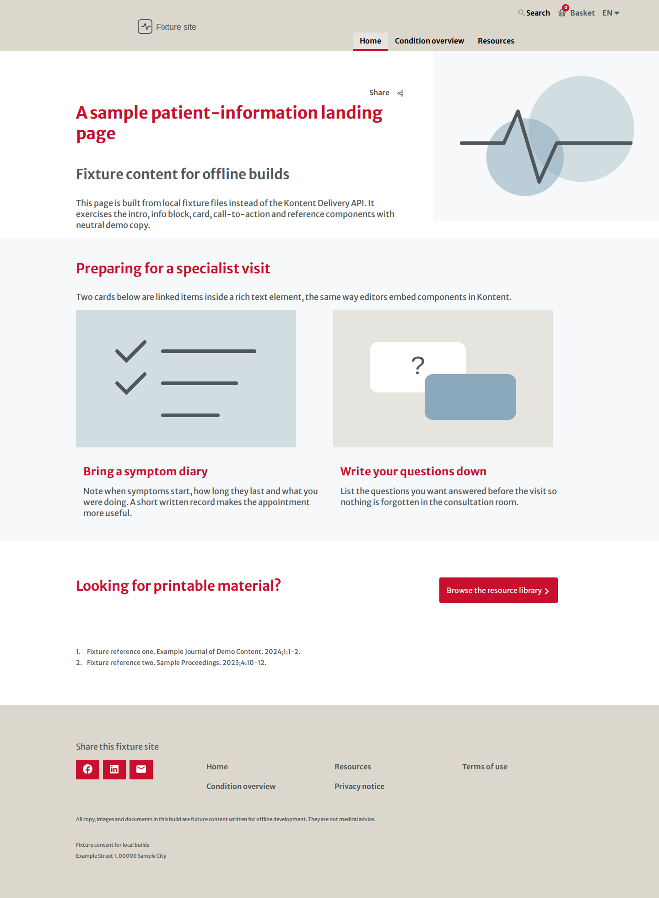
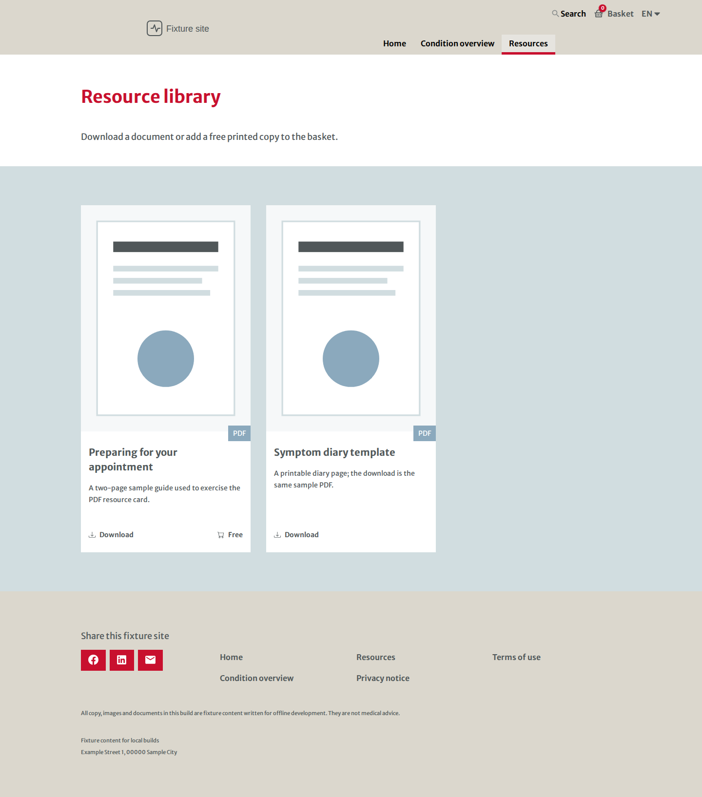
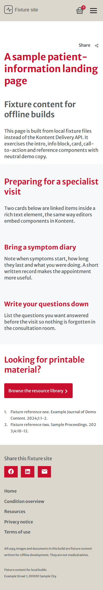
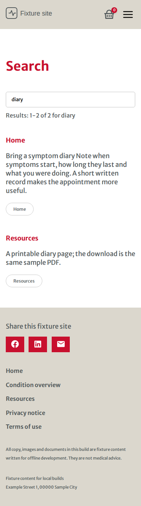
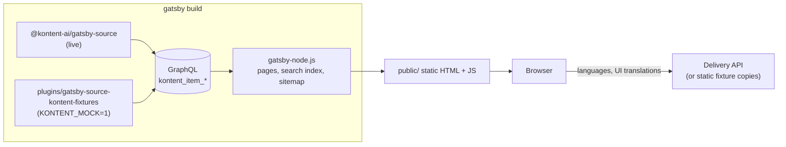

# Treating HF Valve – Gatsby + Kontent site

This repository is a client marketing site build: a patient- and
healthcare-professional information site about heart failure and tricuspid
regurgitation, built with [Gatsby](https://www.gatsbyjs.com/) on top of the
[Kontent.ai](https://kontent.ai/) headless CMS (formerly Kentico Kontent).
The brand, copy, images and documents shown on the live site belong to the
client and are not part of this code base; editors manage them in Kontent.

The code renders whatever the CMS delivers: pages built from intro, info-block,
card, table, infographic, call-to-action and reference components, a resource
library with PDF previews and a free-print basket, a three-step checkout that
hands the order to the client's Marketo form, client-side search, a sitemap and
per-language routes (`/` for English, `/de/` for German).



All screenshots here come from the bundled fixture content (`KONTENT_MOCK=1`),
not from the client's pages.

| Resource library | Mobile home | Mobile search |
| --- | --- | --- |
|  |  |  |

## How it fits together



- Every Kontent page listed under the `site` item's `subpages` becomes a route.
  The search index for `/search` is built from the same GraphQL nodes, so it
  always matches the pages that were built.
- Page HTML is complete at build time. The language list and the UI label
  translations are fetched in the browser afterwards; if that request fails the
  site falls back to English labels instead of rendering nothing.
- Kontent Smart Link attributes (`data-kontent-*`) are kept on components so
  editors can jump from the page to the item in Web Spotlight.

## Running it

Requirements: Node 22 (`.nvmrc`) and npm, or just Docker.

### Without CMS credentials (fixture content)

```bash
npm ci
npm test
npm run build:fixtures
npm run serve:fixtures    # http://localhost:9000
```

`KONTENT_MOCK=1` (set by `build:fixtures` / `develop:fixtures`) swaps the
Kontent source plugin for `plugins/gatsby-source-kontent-fixtures`, which reads
`fixtures/kontent/content.json` and `content-types.json`, recreates the
`kontent_item_*` schema, and publishes static copies of the two Delivery API
responses the browser asks for. Nothing contacts Kontent, the client's Marketo
forms are not loaded, and a neutral logo replaces the client's.

### With Docker

```bash
docker compose up --build  # http://localhost:8080
```

The image runs `npm ci`, the tests and the fixture build, then serves `public/`
from nginx. For a build against the real project, put the settings in `.env`
and pass it as a BuildKit secret so it never ends up in an image layer:

```bash
docker build --build-arg KONTENT_MOCK=0 --secret id=dotenv,src=.env -t thv-headless .
```

### Against the real Kontent project

Copy `.env.example` to `.env` and fill in the project ID, the language
codenames (first one is the default) and the Delivery API URL, then use
`npm run develop` or `npm run build`. Setting `ENVIRONMENT=development` also
creates `/preview/<language>/…` routes for Kontent Web Spotlight.

## Scripts

| Command | What it does |
| --- | --- |
| `npm run develop` / `npm run build` / `npm run serve` | Gatsby dev server / production build / serve `public/`, against Kontent |
| `npm run develop:fixtures` / `npm run build:fixtures` / `npm run serve:fixtures` | Same, using the bundled fixtures |
| `npm test` | Jest + Testing Library (utilities, search index, fixture plugin, components) |
| `npm run lint` | ESLint and a Prettier check |
| `npm run format` | Prettier write |

## Project layout

```text
gatsby-config.js        source selection (Kontent or fixtures), plugins, site metadata
gatsby-node.js          creates page, search and sitemap routes
gatsby/search-index.js  builds js-search documents from GraphQL nodes
plugins/gatsby-source-kontent-fixtures/   offline content source
fixtures/kontent/       fixture items, content types and neutral demo assets
src/templates/          page, event landing, search and sitemap templates
src/containers/         page sections (Intro, InfoBlock, Cards, Navbar, Footer, …)
src/components/         smaller pieces (Card, Resource, PDFViewer, Search, Form, …)
src/context/            basket, language and translation state (ThemeProvider)
src/utils/              paths, Delivery API reads, translation helpers
src/assets/scss/        styles, 7-1 style (see below)
```

## Design notes

- **Fixture source instead of HTTP mocks.** The fixture plugin produces the
  same node types and field shapes as `@kontent-ai/gatsby-source`, so every
  page query, fragment and template runs unchanged in tests, offline builds and
  screenshots. Fixture items are written compactly; linked items inside rich
  text are discovered from their `<object data-codename>` tags, as Kontent does.
- **Home page slugs.** The page served at the language root is chosen by slug
  (`GATSBY_HOME_PAGE_SLUGS`, defaulting to the two slugs the live project uses).
  `src/utils/paths.js` is the single place that turns CMS slugs into routes, for
  pages, navigation, sitemap and search results alike.
- **Basket.** Orders live in React context and `localStorage`; the checkout
  submits them through the client's Marketo form. There is no server side.

## Front-end conventions

### SCSS structure

Based on the [7-1 Sass architecture](https://www.learnhowtoprogram.com/user-interfaces/building-layouts-preprocessors/7-1-sass-architecture),
trimmed to the folders this site uses:

```text
src/assets/scss/
├── abstracts/   variables, mixins, functions (no CSS output)
├── base/        reset, typography, utility classes and the grid
├── layouts/     navbar, footer
├── components/  one folder per component (card, resource, search, …)
└── main.scss    imports everything in that order
```

Class names follow BEM (`.card`, `.card__title`, `.card__title--primary`).

### Components and containers

- **Components** are small UI pieces that can sit inside a container: Card,
  Resource, Video, Table.
- **Containers** are page sections that compose components: Navbar, Intro,
  InfoBlock, Cards.

A component with more than one look gets a `variants/` folder
(`Table/variants/Basic`, `Navbar/variants/NavbarDefault`) and a matching
partial (`scss/components/table/_tableBasic.scss`). The `index.js` next to the
variants picks one from the CMS `variant` value.

### Units, colours and breakpoints

Use `rem` (base 16px) and the variables in `abstracts/_variables.scss` rather
than literal values.

| Variable | Hex |
| --- | --- |
| `$color-crimson` | `#c8102e` |
| `$color-slate` | `#505759` |
| `$color-sky` | `#8ba9bd` |
| `$color-sky-light` | `#f6f8f9` |
| `$color-steel` | `#d1dde0` |
| `$color-primary` | `#dbd7cd` |
| `$color-focus` | `#0099ff` |

Breakpoints are min-width: default `0`, `md` 768px, `lg` 1024px, used through
the mixins (`@include md { … }`).

### Grid and utilities

`base/_utilities.scss` generates CSS-grid helpers:

- `grid-N` / `grid-md-N`: N equal columns (all breakpoints / from `md` up).
- `col-md-N`: span N of a 12-column grid (`grid-md-12`).
- `start-md-N` / `end-md-N`: explicit start and end lines (1–13).
- `gap-N` / `gap-md-N`: gap in rem (default gap is 2rem).
- `order-N` / `order-md-N`: reorder items per breakpoint.
- `mt-*`, `mb-*`, `pt-*`, `pb-*`, `ml-*`, `mr-*`, `text-center`, `d-none`,
  `d-block`, `bg-<colour>`, `text-<colour>`, and `visually-hidden` for text
  that only screen readers should get.

```html
<div class="grid-1 grid-md-12 gap-1 gap-md-2">
  <div class="col-md-4">Sidebar</div>
  <div class="col-md-8">Main content</div>
</div>
```

New utilities are added to the `$utilities` map in the same file.

## License

The code keeps the MIT license that came with the original Kontent starter
(see `LICENSE`). That license covers the code only; the client's brand,
content and images are not licensed by this repository.
